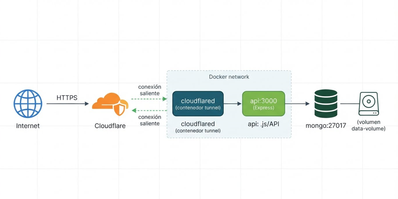
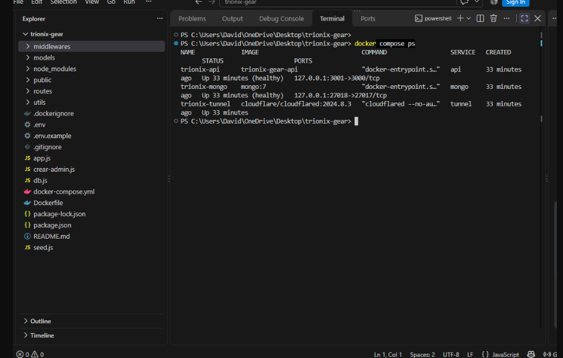
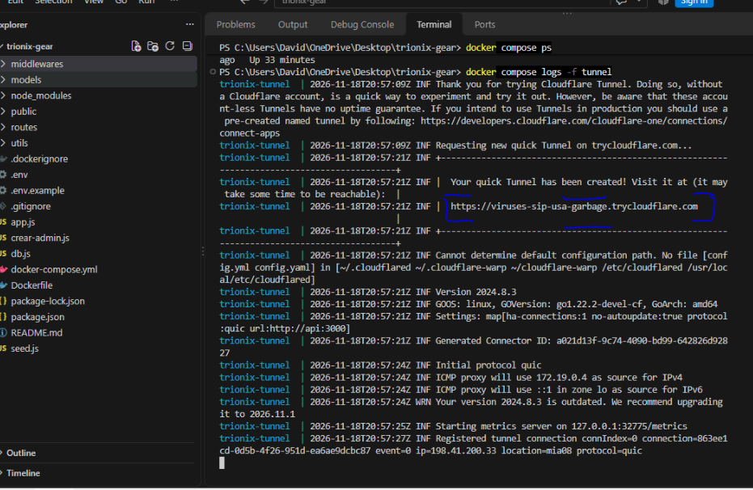

# Trionix Gear — Sistema de préstamo de equipos

**Estudiante:** David [Tu Apellido] · Electiva Web Avanzada · Universidad Simón Bolívar  
**Fecha de entrega:** 18 de noviembre de 2026

Aplicación web integral para gestionar el inventario de Trionix Labs y sus préstamos institucionales. Desarrollada con una arquitectura robusta basada en una API REST (Node.js, Express, Joi), una base de datos NoSQL con control atómico (MongoDB, Mongoose) y un frontend estático integrado. Se despliega mediante contenedores Docker Compose con verificaciones de salud (*healthchecks*) y se publica de forma segura a Internet mediante Cloudflare Tunnel.

---

## 📋 Tabla de Contenidos
1. [Requisitos Previos](#requisitos-previos)
2. [Instrucciones de Despliegue](#instrucciones-de-despliegue)
3. [URL Pública (Quick Tunnel)](#url-pública-quick-tunnel)
4. [Variables de Entorno (`.env.example`)](#variables-de-entorno-env-example)
5. [Arquitectura y Diagrama de Flujo](#arquitectura-y-diagrama-de-flujo)
6. [Autenticación y Seguridad](#autenticación-y-seguridad)
7. [Referencia de Endpoints](#referencia-de-endpoints)
8. [Decisiones Técnicas Clave](#decisiones-técnicas-clave)
9. [Bonus Implementados](#bonus-implementados)
10. [Evidencias Requeridas para la Sustentación](#evidencias-requeridas-para-la-sustentación)

---

## 🛠️ Requisitos Previos
* **Docker Desktop** (con soporte WSL2 activado en Windows) o **Docker Engine** con Compose v2.
* Node.js (opcional, solo si deseas ejecutar pruebas unitarias o de siembra en local sin contenedores).

---

## 🚀 Instrucciones para Levantarlo con Docker Compose

Ejecuta los siguientes comandos en la terminal desde la raíz del proyecto:

```bash
# 1. Copiar y configurar las variables de entorno
cp .env.example .env        # Configura tus secretos (JWT_SECRET, ADMIN_PASSWORD)

# 2. Descargar y construir las imágenes (Hazlo antes de llegar a la universidad)
docker compose pull && docker compose build

# 3. Levantar los contenedores en segundo plano
docker compose up -d --build

# 4. Sembrar la base de datos con datos de prueba y usuario administrador
docker compose exec api node seed.js

# 5. Validar que los servicios críticos estén operativos y saludables
docker compose ps
```

* **Acceso local:** `http://localhost:3001`
* **Reiniciar sin perder datos:** `docker compose down && docker compose up -d` (los datos persisten gracias al volumen `data-volume`).
* **Borrar todo y reiniciar desde cero:** `docker compose down -v`.

---

## 🌐 URL Pública (Quick Tunnel)

Para exponer la aplicación de forma pública, segura y con cifrado HTTPS extremo a extremo sin necesidad de un dominio propio, el sistema utiliza un contenedor de Cloudflare Tunnel.

Para obtener tu enlace temporal activo en tiempo real:
```bash
docker compose logs tunnel
```
Busca en los logs una línea que contenga una URL pública del tipo:  
`https://[id-aleatorio].trycloudflare.com`  
*(Nota: Esta URL se genera automáticamente al iniciar el túnel y puede cambiar al reiniciar el contenedor).*

---

## 🔐 Variables de Entorno (`.env.example`)

Crea un archivo `.env` basado en la siguiente estructura (nunca subas credenciales reales al repositorio):

| Variable | Descripción | Ejemplo / Valor por defecto |
|---|---|---|
| `PORT` | Puerto interno de escucha de la API Express | `3000` |
| `MONGODB_URI` | Cadena de conexión a MongoDB (usando el nombre del servicio Docker) | `mongodb://mongo:27017/trionixgear` |
| `JWT_SECRET` | Llave secreta para firmar y verificar los JSON Web Tokens | `tu_clave_secreta_jwt_muy_segura` |
| `JWT_EXPIRES_IN` | Tiempo de expiración de la sesión del administrador | `8h` |
| `ADMIN_USERNAME` | Nombre de usuario inicial para el administrador del sistema | `admin` |
| `ADMIN_PASSWORD` | Contraseña inicial (mínimo 8 caracteres exigidos por `seed.js`) | `Admin123*` |

---

## 📐 Diagrama de Flujo




**Explicación:** Todo el stack opera dentro de una red interna aislada de Docker. El túnel opera mediante **conexiones salientes** iniciadas por el contenedor `cloudflared` hacia la infraestructura de Cloudflare. Esto permite recibir tráfico público seguro de forma externa sin necesidad de abrir puertos en el router ni poseer una dirección IP pública estática.

---

## 🔑 Autenticación
* **Ruta de Acceso:** `POST /api/auth/login` (devuelve un token JWT válido).
* **Políticas de Acceso:** 
  * Las peticiones `GET` públicas y `/api/health` son de libre acceso.
  * Las operaciones de escritura y mutación (`POST`, `PUT`, `PATCH`, `DELETE`) sobre equipos, usuarios y préstamos exigen cabecera de autorización: `Authorization: Bearer <token>`.

---

## 📡 Tabla de Endpoints

| Método | Ruta | Códigos de Respuesta Exitosos / Errores |
|---|---|---|
| GET | `/api/health` | 200 (OK), 503 (Error de conexión BD) |
| POST | `/api/auth/login` | 200, 400 (Faltan datos), 401 (Credenciales inválidas) |
| GET | `/api/auth/me` | 200, 401 (Token faltante o expirado) |
| GET | `/api/equipos` | 200, 400 (Parámetros inválidos) |
| GET | `/api/equipos/:id` | 200, 400, 404 (No encontrado) |
| GET | `/api/equipos/:id/prestamos` | 200, 400, 404 |
| POST | `/api/equipos` | 201 (Creado), 400, 401, 409 (Código duplicado) |
| PUT | `/api/equipos/:id` | 200, 400, 401, 404, 409 |
| DELETE | `/api/equipos/:id` | 200, 400, 401, 404, 409 (Equipo en estado prestado) |
| GET | `/api/usuarios` | 200, 400 |
| GET | `/api/usuarios/:id` / `/:id/prestamos` | 200, 400, 404 |
| POST | `/api/usuarios` | 201, 400, 401, 409 (Documento o correo duplicado) |
| PUT | `/api/usuarios/:id` | 200, 400, 401, 404, 409 |
| DELETE | `/api/usuarios/:id` | 200, 400, 401, 404, 409 (Usuario con préstamos activos) |
| GET | `/api/prestamos` | 200, 400 |
| GET | `/api/prestamos/:id` | 200, 400, 404 |
| POST | `/api/prestamos` | 201, 400, 401, 404, 409 (Equipo no disponible) |
| PATCH | `/api/prestamos/:id/devolver` | 200, 400, 401, 404, 409 (Préstamo ya devuelto) |
| GET | `/api/reportes/top-equipos` | 200, 400 |
| GET | `/api/reportes/resumen` | 200 |

---

## ⚙️ Decisiones Técnicas

* **Concurrencia Atómica (R8):** Para evitar condiciones de carrera (*race conditions*) donde dos solicitudes lean el estado "disponible" de un equipo simultáneamente, la asignación se realiza mediante una única operación atómica condicional: `findOneAndUpdate({ _id, estado: "disponible" }, { estado: "prestado" })`. Si la creación del documento de préstamo falla posteriormente, se ejecuta una rutina de compensación para revertir el estado del equipo. Adicionalmente, se implementó un índice único parcial en la base de datos sobre el equipo activo.
* **Cálculo Dinámico de Vencidos (R6):** El estado de vencimiento no se persiste estáticamente en disco; se calcula en tiempo de ejecución evaluando reglas de negocio (`estado == 'activo'` y `fechaLimite < Date.now()`).
* **Manejo Centralizado de Errores:** Se implementó un middleware global que intercepta errores de validación de Joi, errores de Mongoose (`ValidationError`, `CastError`) y duplicidad de índices en MongoDB (código 11000), respondiendo estandarizadamente con códigos HTTP `400`, `404` o `409`.
* **Optimización del Dockerfile:** Se utiliza la imagen base oficial `node:22-alpine`, separando la copia de dependencias (`package*.json` y `npm ci --omit=dev`) del código fuente para aprovechar de manera eficiente la caché de capas de Docker. La aplicación se ejecuta bajo un usuario sin privilegios (`node`).

---

## 🎁 Bonus Implementados
1. **Orquestación y Healthchecks Robustos:** Configuración de dependencias secuenciales estrictas (`service_healthy`) entre MongoDB, la API Express y el túnel de Cloudflare.
2. **Exposición Segura sin Apertura de Puertos:** Integración automatizada con Cloudflare Tunnel (Quick Tunnel).
3. **Paginación Optimizada con Índices Compuestos:** Endpoints de listados masivos soportan paginación avanzada (`?page=&limit=`) respaldada por índices compuestos en MongoDB (`{ estado: 1, fechaPrestamo: -1, _id: -1 }`), evitando ordenamientos costosos en memoria RAM.

---

## 📸 Evidencias Requeridas para la Sustentación

Guía de referencias operativas para verificar el correcto funcionamiento del sistema:

1. **Estado de Contenedores (`docker compose ps`):**  

   Muestra los tres servicios (`trionix-mongo`, `trionix-api`, `trionix-tunnel`) activos simultáneamente con estado `Up` y validación de salud (`healthy`).
2. **Siembra de Base de Datos (`seed.js`):**
  
   Comprobación en consola del reseteo y carga limpia de colecciones (8 equipos, 5 usuarios, 6 préstamos y credenciales del administrador).
3. **Interfaz y Datos Reales en la URL de Cloudflare:** 
 
   Visualización de la aplicación web operando desde el exterior mediante el dominio seguro `trycloudflare.com`.
4. **Consulta Poblada (`GET /api/prestamos`):**  
   Respuesta JSON resolviendo de forma íntegra los campos relacionados de equipos y usuarios mediante referencias (`populate`).
5. **Protección de Reglas de Negocio (Código 409):**  
   Validación del rechazo automático e informativo al intentar prestar un equipo que ya se encuentra bajo estado `prestado`.
6. **Inspección Interna en MongoDB (`mongosh`):**  
   Ejecución de `show collections` dentro del contenedor de la base de datos confirmando la existencia de las colecciones `admins`, `equipos`, `usuarios` y `prestamos`.